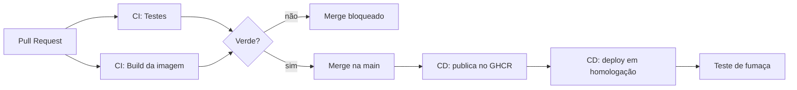

# TaskFlow

Gerenciador de tarefas usado como projeto da disciplina de DevOps. A aplicação
é pequena de propósito: o objeto do trabalho são as práticas de engenharia em
volta dela — ramificação, commits padronizados, Integração Contínua,
containerização, Entrega Contínua, gestão de segredos e rollback.

## Como rodar

### Com Docker (recomendado)

Sobe a aplicação e o banco juntos, com um comando:

```bash
cp .env.example .env     # preencha POSTGRES_PASSWORD
docker compose up --build
```

Acesse <http://localhost:3000>.

Para derrubar tudo, inclusive os dados:

```bash
docker compose down -v
```

### Sem Docker

Requer Node.js 20 e um PostgreSQL acessível.

```bash
cp .env.example .env     # ajuste a DATABASE_URL
npm ci
npm start                # http://localhost:3000
npm test                 # 18 testes
```

## Interface

A página em `public/index.html` é servida pela própria aplicação na raiz.
Permite criar tarefa, filtrar por situação, concluir e apagar — tudo
consumindo a API por `fetch`.

## Endpoints

| Método | Rota | O que faz |
| --- | --- | --- |
| `GET` | `/health` | Verifica a aplicação e a conexão com o banco |
| `GET` | `/tasks` | Lista as tarefas (filtro: `?status=pendente`) |
| `GET` | `/tasks/:id` | Busca uma tarefa |
| `POST` | `/tasks` | Cria uma tarefa (campo `title`, mínimo 3 caracteres) |
| `PATCH` | `/tasks/:id/concluir` | Marca como concluída |
| `DELETE` | `/tasks/:id` | Apaga uma tarefa |

```bash
curl -X POST http://localhost:3000/tasks \
  -H 'Content-Type: application/json' \
  -d '{"title": "Estudar containers"}'
```

## Estrutura

```
src/
├── db.js       conexão com o PostgreSQL e criação da tabela
├── tasks.js    regras de negócio e consultas
├── app.js      rotas HTTP e entrega da interface
└── server.js   sobe o servidor

public/
└── index.html  interface de interação

tests/
├── tasks.test.js  unitários (regras puras, sem banco)
└── api.test.js    integração (HTTP + PostgreSQL real)
```

## Testes

São 18 testes de dois tipos:

- **Unitários** — exercitam as regras de validação diretamente: título com menos
  de 3 caracteres, status inexistente, id inválido. Não tocam no banco nem no
  HTTP, então rodam em milissegundos.
- **Integração** — fazem requisições HTTP reais contra a aplicação com um
  **PostgreSQL de verdade** por trás, verificando códigos de resposta
  (201, 204, 400, 404) e a persistência entre requisições.

No pipeline o banco sobe como *service container*; na máquina do
desenvolvedor, pelo `docker compose`. Em nenhum dos dois casos o teste roda
contra um substituto — se a consulta SQL estiver errada, o teste quebra.

## Containerização

O [`Dockerfile`](Dockerfile) usa **multi-stage build**:

| Decisão | Motivo |
| --- | --- |
| Base `node:20-alpine` | Imagem muito menor que a `node:20` completa |
| Dependências em etapa separada | O Docker reaproveita a camada enquanto o `package-lock.json` não muda |
| `npm ci --omit=dev` | Jest e Supertest servem ao pipeline, não à imagem de produção |
| Etapa final sem ferramentas de build | Só `node_modules`, `src` e `public` chegam na imagem |
| `USER node` | A aplicação não roda como root, limitando o estrago em caso de invasão |
| `HEALTHCHECK` | O Docker marca o contêiner como *unhealthy* se a aplicação parar de responder |
| [`.dockerignore`](.dockerignore) | Testes, `.git` e `node_modules` local nunca entram no contexto de build |

## Orquestração local

O [`docker-compose.yml`](docker-compose.yml) sobe a aplicação **integrada com
sua dependência**:

- `banco` — PostgreSQL 16, com volume nomeado para os dados sobreviverem ao
  `docker compose down`, e *healthcheck* via `pg_isready`
- `aplicacao` — construída a partir do `Dockerfile`, só inicia depois que o
  banco passa no healthcheck (`depends_on: condition: service_healthy`)

Sem essa condição, a aplicação subiria antes do banco aceitar conexões e
falharia na primeira consulta.

## Pipelines



### CI — [`.github/workflows/ci.yml`](.github/workflows/ci.yml)

Roda a cada push na `main` e a cada Pull Request:

- **Testes** — sobe o PostgreSQL como service container, instala as
  dependências com `npm ci` e roda a suíte
- **Build da imagem** — constrói o `Dockerfile` sem publicar, para que um
  Dockerfile quebrado seja descoberto no Pull Request e não depois do merge

### CD — [`.github/workflows/cd.yml`](.github/workflows/cd.yml)

- **Construir e publicar imagem** — autentica no GitHub Container Registry,
  calcula as etiquetas e publica
- **Deploy em homologação** — baixa a imagem publicada, sobe banco e aplicação
  como contêineres numa rede isolada e roda um **teste de fumaça**: consulta o
  `/health`, cria uma tarefa e lê de volta. Se qualquer passo falhar, o deploy
  é considerado falho e o pipeline fica vermelho.

O ambiente de homologação é simulado no próprio runner — os mesmos contêineres
que subiriam num servidor real.

## Versionamento semântico

As imagens são etiquetadas a partir das tags do Git:

| Evento | Etiquetas geradas |
| --- | --- |
| Push na `main` | `latest`, `sha-<commit>` |
| Tag `v1.2.3` | `1.2.3`, `1.2`, `latest`, `sha-<commit>` |

Para publicar uma versão:

```bash
git tag v1.0.0
git push origin v1.0.0
```

A etiqueta `sha-<commit>` garante que **toda** imagem publicada seja
rastreável até o commit exato que a originou, mesmo sem uma tag de versão.

## Rollback

Toda versão publicada continua disponível no registry, então voltar atrás é
reimplantar uma etiqueta anterior — não reverter código.

**Pela interface do GitHub:** aba **Actions** → workflow **CD** → **Run
workflow** → informe a versão em `versao` (ex: `1.0.0`) → **Run**.

**Pela linha de comando:**

```bash
gh workflow run cd.yml -f versao=1.0.0
```

O job de homologação detecta que a execução foi manual, **pula a etapa de
build** e implanta direto a versão informada. O teste de fumaça roda
normalmente, então um rollback para uma versão também quebrada é detectado.

### Simulação documentada

| Passo | Ação | Resultado esperado |
| --- | --- | --- |
| 1 | `git tag v1.0.0 && git push origin v1.0.0` | Imagem `1.0.0` publicada e implantada |
| 2 | Merge de uma mudança com defeito na `main` | Imagem `latest` publicada e implantada |
| 3 | Teste de fumaça falha, ou o defeito aparece em homologação | Pipeline vermelho / comportamento errado |
| 4 | **Run workflow** com `versao = 1.0.0` | Homologação volta à versão anterior em segundos |
| 5 | Corrigir o defeito pelo fluxo normal de Pull Request | `v1.0.1` publicada |

O rollback não altera o histórico do Git: o commit com defeito continua
registrado, e a correção entra como uma versão nova.

## Gestão de segredos

Nenhuma senha, token ou string de conexão aparece no código-fonte.

| Segredo | Onde fica | Quem usa |
| --- | --- | --- |
| `POSTGRES_PASSWORD` | Secrets do GitHub Actions | CI (service container) e CD (homologação) |
| `GITHUB_TOKEN` | Gerado automaticamente a cada execução | Autenticação no GHCR |
| Credenciais locais | Arquivo `.env`, fora do versionamento | Desenvolvimento |

O [`.env.example`](.env.example) é versionado como modelo, com valores de
exemplo. O `.env` real está no [`.gitignore`](.gitignore) e nunca sai da
máquina do desenvolvedor.

O `GITHUB_TOKEN` merece destaque: ele é criado pelo Actions no início da
execução e expira no fim dela. Não existe credencial de registry para alguém
vazar, porque não existe credencial permanente.

## Estratégia de ramificação: Trunk-Based Development

A `main` é a única branch permanente e está sempre em estado entregável.
Branches de funcionalidade duram até 2 dias e voltam por Pull Request.

```
main  ──●───●───●───●───●───●──▶   sempre verde
         \     /     \     /
          ●───●       ●───●        branches curtos
```

```bash
git checkout main && git pull
git checkout -b feat/nome-da-mudanca
git commit -m "feat: descricao da mudanca"
git push -u origin feat/nome-da-mudanca
```

### Por que Trunk-Based e não Git Flow

| | Trunk-Based | Git Flow |
| --- | --- | --- |
| Integração | Diária | Só ao fechar a release |
| Conflitos de merge | Raros e pequenos | Frequentes e grandes |
| Retorno do CI | Em minutos | Tardio |
| Branches permanentes | 1 | 2 ou mais |

Git Flow foi feito para software com várias versões em produção ao mesmo
tempo. Para uma aplicação entregue continuamente, seus branches longos criam o
problema que a Integração Contínua existe para resolver.

## Regras de proteção da branch principal

| Regra | Efeito |
| --- | --- |
| Pull Request obrigatório, 1 aprovação | Ninguém dá push direto na `main` |
| Status check `Testes` obrigatório | Nada entra com o pipeline vermelho |
| Branch atualizado antes do merge | O código é testado contra a `main` atual |
| Force push bloqueado | O histórico da `main` não é reescrito |
| Exclusão da branch bloqueada | A `main` não pode ser apagada |
| Histórico linear | Só squash merge |

## Padrão de commits

Todo commit segue o **Conventional Commits**:

```
<tipo>: <descrição no imperativo>
```

Tipos usados: `feat`, `fix`, `docs`, `test`, `chore`, `ci`, `build`.

```
feat: adiciona interface de interacao
build: adiciona Dockerfile multi-stage
ci: publica a imagem no GHCR a cada push na main
```

Um histórico padronizado permite gerar changelog automaticamente e deduzir a
próxima versão semântica a partir dos tipos de commit.
